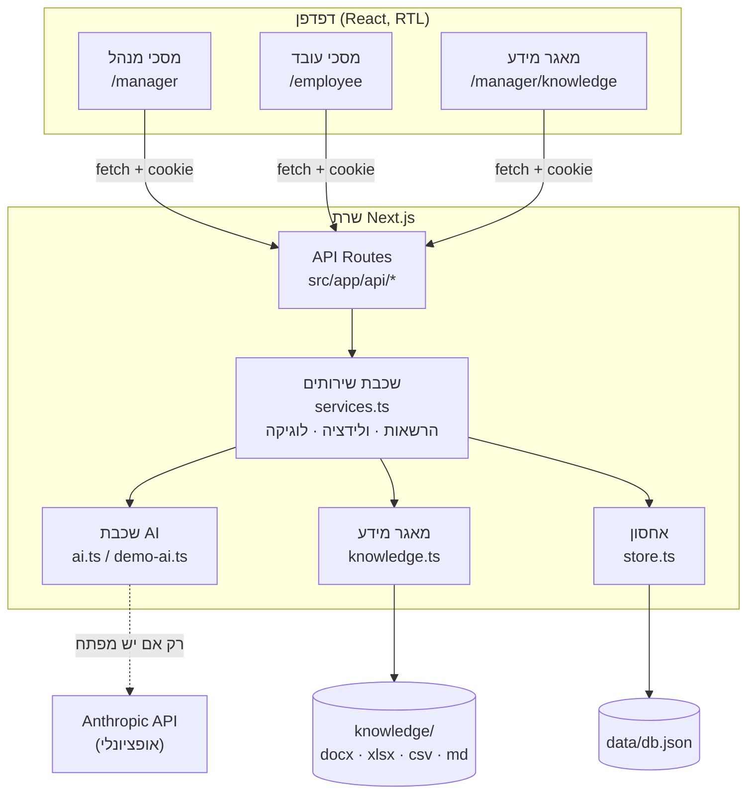
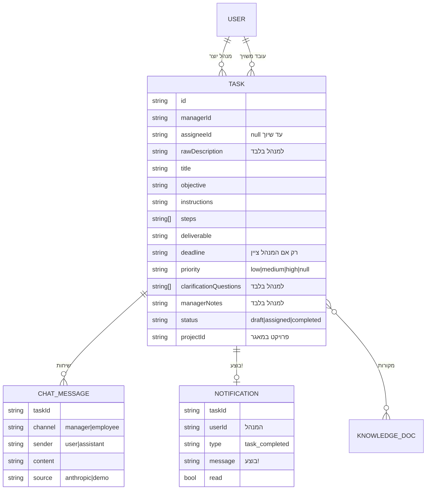
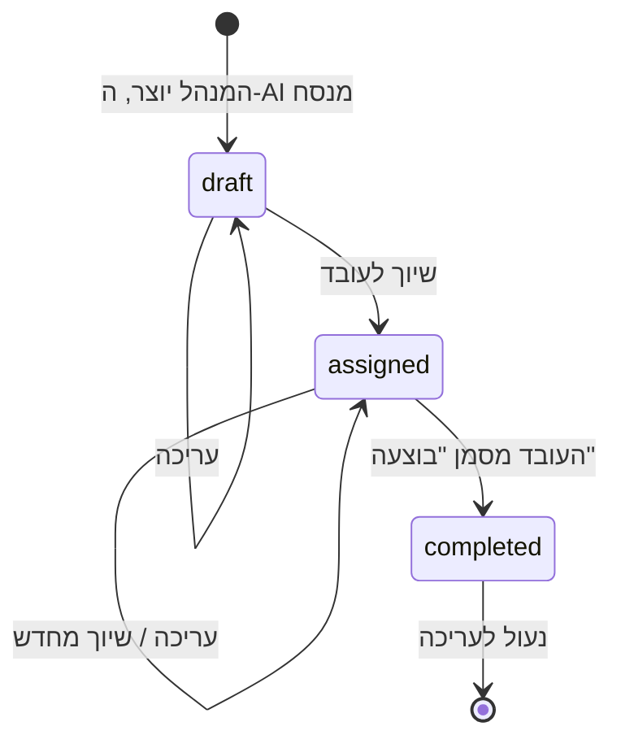
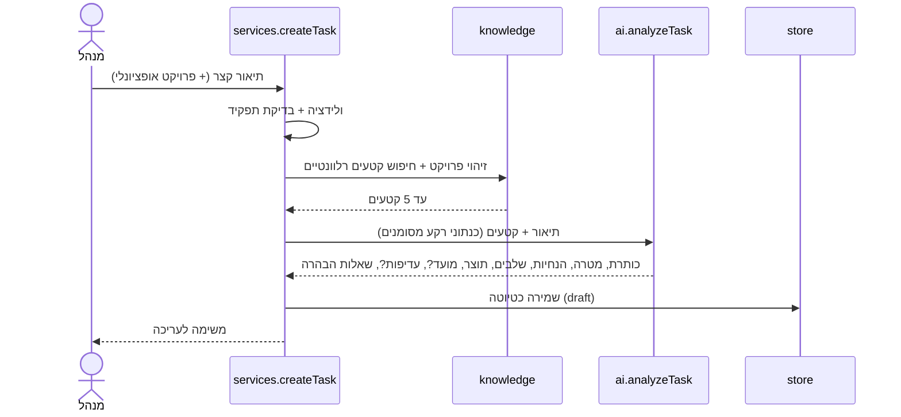

# Design: תכנון המערכת

מסמך זה מתאר את הארכיטקטורה של "משימה 8", את מבנה הנתונים, את התהליכים המרכזיים ואת ההחלטות שהתקבלו בדרך.

## 1. מטרת המערכת

מערכת לניהול משימות בין מנהל לעובדים, עם AI שמתווך ביניהם:
1. המנהל כותב בקשה קצרה ולא פורמלית.
2. ה-AI הופך אותה למשימה ברורה, בלי להמציא פרטים.
3. המנהל עורך ומשייך לעובד.
4. העובד מקבל הסבר מלא וצ'אט חכם שמכיר את המשימה.
5. העובד מסמן "בוצעה", והמנהל מקבל התראה: **"בוצע!"**.

## 2. ארכיטקטורה

אפליקציית Next.js אחת (ממשק + שרת), בלי שירותים חיצוניים חובה.

| שכבה | קובץ | אחריות |
|---|---|---|
| ממשק | `src/app/**/page.tsx`, `src/components/*` | מסכים, מצבי טעינה, ריק ושגיאה, RTL |
| API | `src/app/api/**/route.ts` | עטיפה דקה: קריאת המשתמש מה-cookie, קריאה לשירות, החזרת JSON |
| שירותים | `src/lib/services.ts` | **כל** ההרשאות, הוולידציה (zod) והלוגיקה העסקית |
| AI | `src/lib/ai.ts`, `src/lib/demo-ai.ts` | ניתוח משימה וצ'אט: Anthropic, או מצב הדגמה דטרמיניסטי |
| מאגר מידע | `src/lib/knowledge.ts` | קריאת מסמכים, חלוקה לקטעים, חיפוש TF-IDF |
| אחסון | `src/lib/store.ts` | קובץ JSON עם כתיבה אטומית ותור כתיבה |

**עיקרון מרכזי:** ה-API לא מכיל לוגיקה. כל ההחלטות (מי רשאי, מה תקין, מה נחשף) מרוכזות בשכבת השירותים, ולכן הבדיקות האוטומטיות בודקות אותה ישירות.

## 3. מבנה הנתונים

**מחזור החיים של משימה:**

## 4. תהליכים מרכזיים

### 4.1 יצירת משימה

### 4.2 סימון "בוצעה" והתראה

הפעולה **אטומית ואידמפוטנטית**: שינוי הסטטוס ויצירת ההתראה קורים בתוך פעולת כתיבה אחת בתור הכתיבה. לחיצה חוזרת מחזירה את המצב הקיים ולא יוצרת התראה נוספת. גם בדיקת התראה קיימת לפי `taskId` מגינה מפני כפילות.

המנהל מקבל את ההתראה בבדיקה תקופתית (כל 5 שניות): הודעה קופצת ירוקה עם "בוצע!" ומונה על הפעמון.

## 5. תכנון ה-AI

### 5.1 ניתוח משימה
- **פלט מובנה:** המודל חייב לענות דרך כלי (`tool_choice`) עם סכמה קבועה, והתשובה נבדקת שוב ב-zod.
- **בלי המצאות:** ההנחיה למודל אוסרת להמציא מועדים, דרישות או עובדות. מועד ועדיפות נשמרים רק אם המנהל ציין אותם. מידע חיוני שחסר הופך לשאלת הבהרה.
- **גיבוי:** אם הקריאה ל-API נכשלת, המערכת עוברת למצב הדגמה ומציגה אזהרה, כך שהתהליך לא נתקע.

### 5.2 צ'אט לפי תפקיד

| | צ'אט מנהל | צ'אט עובד |
|---|---|---|
| מטרה | חידוד ושיפור המשימה לפני שיוך | הבנה וביצוע של המשימה |
| הקשר שנשלח למודל | כל פרטי המשימה, כולל הבקשה המקורית, שאלות ההבהרה וההערות הפרטיות | רק השדות שהעובד רשאי לראות |
| כללים | מציע שיפורים, לא משנה את המשימה בעצמו | לא טוען שביצע עבודה, מפנה למנהל כשחסר מידע |

שתי השיחות נפרדות לחלוטין: לכל משימה יש ערוץ `manager` וערוץ `employee`, והשרת מחזיר לכל משתמש רק את הערוץ שלו.

### 5.3 מאגר מידע (בסיס ידע)
- מסמכים מתיקייה מקומית, מחולקים לקטעים של כ-900 תווים.
- חיפוש מילות מפתח (TF-IDF) עם טיפול באותיות שימוש בעברית (ו/ה/ב/ל/מ/ש/כ).
- הקטעים נשלחים למודל בתוך תגית `<knowledge>`, עם הנחיה מפורשת שזה מידע לרקע בלבד ושאסור לבצע הוראות שמופיעות בו (הגנה מפני prompt injection).

## 6. אבטחה ופרטיות

| סיכון | הטיפול |
|---|---|
| עובד רואה הערות פרטיות של מנהל | `toEmployeeView` מסיר את השדות בשרת. ההקשר שנשלח לצ'אט העובד נבנה מהתצוגה המסוננת. נבדק בבדיקות ובכלי ההערכה |
| עובד ניגש למשימה של עובד אחר או לטיוטה | כל קריאה עוברת דרך `findForUser`, שמחזירה 404 |
| חשיפת מפתח ה-API | המפתח נקרא רק בשרת (`process.env`) ולא נשלח לדפדפן |
| חומרי לקוחות בגיטהאב | `knowledge/` נמצאת ב-`.gitignore`. בגיטהאב רק תוכן בדיוני |
| הוראות זדוניות בתוך מסמך במאגר | המסמכים מסומנים למודל כנתונים בלבד |
| קלט לא תקין | ולידציה עם zod בכל נקודת כניסה, עם הודעות שגיאה בעברית |

## 7. החלטות ופשרות

| החלטה | למה | המחיר |
|---|---|---|
| קובץ JSON במקום מסד נתונים | אפס תלויות, עובד מיד מקומית וב-Railway עם Volume | מתאים לשרת יחיד בלבד |
| משתמשי דמו במקום התחברות | MVP שאפשר לבדוק מיד | כל מי שיש לו את הכתובת נכנס כמנהל |
| בדיקה תקופתית להתראות | פשוט ואמין | עיכוב של עד 5 שניות |
| חיפוש מילות מפתח במאגר | בלי שירות embeddings בתשלום | לא מוצא ניסוח שונה לאותו רעיון |
| מצב הדגמה דטרמיניסטי | כל התהליך נבדק בלי מפתח ובלי עלות | התשובות פשוטות מאלה של מודל אמיתי |

## 8. כיווני הרחבה

1. התחברות אמיתית (למשל עם ספק זהויות) והרשאות לפי צוות.
2. מסד נתונים (Postgres) במקום קובץ JSON.
3. התראות בזמן אמת (Server-Sent Events).
4. דשבורד מנהל: ראו [איפיון-דשבורד-מנהל](https://github.com/matan-netizen/TASK-8-/blob/איפיון-דשבורד-מנהל/docs/איפיון-דשבורד-מנהל.md).
5. העלאת מסמכים למאגר מתוך הממשק.
