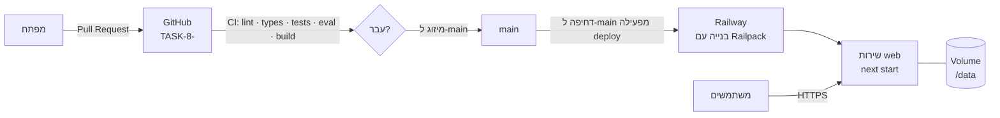

# Place: איפה ואיך המערכת רצה

## 1. סביבות

| סביבה | איפה | כתובת | נתונים |
|---|---|---|---|
| **פיתוח** | המחשב של המפתח | http://localhost:3000 | `./data/db.json` |
| **ייצור (Production)** | Railway, פרויקט `task-8`, שירות `web` | https://web-production-c4854.up.railway.app | Volume קבוע ב-`/data` |

## 2. הרצה מקומית

דרישות: Node.js 20 ומעלה.

```bash
npm install
```
```bash
npm run dev
```

אופציונלי: מעתיקים את `.env.example` ל-`.env.local` וממלאים את המשתנים (ראו סעיף 4).

## 3. ייצור ב-Railway



**איך זה עובד:**
- השירות מחובר לענף `main` במאגר. **כל מיזוג או דחיפה ל-`main` מעלה גרסה חדשה אוטומטית.**
- Railway מזהה פרויקט Node/Next.js ובונה אותו לבד: `npm ci`, אחר כך `npm run build`, ובסוף `npm start`.
- Next.js מאזין לפורט שמגיע במשתנה `PORT` (ב-Railway: 8080).
- **Volume** קבוע מחובר ל-`/data`. בו נשמרים המשימות, ההודעות וההתראות, והם לא נמחקים בעדכונים או בהפעלה מחדש.
- **בדיקת תקינות:** הנתיב `/api/health` מחזיר 200 כשהשרת והאחסון תקינים, ו-503 אם לא.

## 4. משתני סביבה

| משתנה | חובה? | ערך בייצור | תיאור |
|---|---|---|---|
| `DATA_DIR` | בייצור כן | `/data/db` | תיקיית קובץ הנתונים. חייבת להיות בתוך ה-Volume |
| `ANTHROPIC_API_KEY` | לא | מוגדר על ידי הבעלים בלוח הבקרה | בלעדיו המערכת עובדת במצב הדגמה |
| `ANTHROPIC_MODEL` | לא | ברירת מחדל: `claude-sonnet-5-5` | החלפת מודל |
| `KNOWLEDGE_DIR` | לא | ברירת מחדל: `./knowledge` | תיקיית מסמכי המאגר. אם לא קיימת, משתמשים במאגר הדוגמה |
| `PORT` | לא | Railway מגדיר לבד | הפורט שהשרת מאזין לו |

> **את מפתח ה-API מגדירים רק בלוח הבקרה של Railway** (פרויקט task-8, שירות web, לשונית Variables), לא בקוד, לא בגיטהאב ולא בצ'אט.

## 5. הקמה מאפס (אם צריך לבנות מחדש)

1. ב-Railway: New Project, ואז Deploy from GitHub repo, ובוחרים `matan-netizen/TASK-8-` (ענף `main`).
   - **חשוב להעלאה אוטומטית:** אפליקציית Railway בגיטהאב צריכה גישה למאגר (https://github.com/settings/installations, ואז Railway). בלי זה Railway לא מקבל הודעה על מיזוגים, וצריך להפעיל כל העלאה ידנית.
   - ב-Settings, תחת Source: מוודאים שהענף הוא `main` ושההעלאה האוטומטית מופעלת. אפשר להפעיל גם **Wait for CI**, כדי שגרסה תעלה רק אחרי שהבדיקות בגיטהאב עברו.
2. בשירות שנוצר: מוסיפים Volume עם mount path ‏`/data`.
3. בלשונית Variables: `DATA_DIR=/data/db`, ואם רוצים AI אמיתי גם `ANTHROPIC_API_KEY`.
4. ב-Settings: מגדירים Healthcheck Path ל-`/api/health`.
5. ב-Settings, תחת Networking: לוחצים Generate Domain.
6. בודקים שהכתובת `https://<domain>/api/health` מחזירה `"status": "ok"`.

## 6. חזרה לגרסה קודמת (Rollback)

**אפשרות 1, דרך Railway (הכי מהיר):** בשירות web, בלשונית Deployments, בוחרים גרסה קודמת שהצליחה ולוחצים Redeploy.

**אפשרות 2, דרך גיטהאב:** פותחים Pull Request שמבטל (revert) את השינוי הבעייתי וממזגים אותו. Railway יעלה את הגרסה המתוקנת אוטומטית.

## 7. מאגר המידע בייצור

התיקייה `knowledge/` לא נמצאת בגיטהאב, ולכן לא מגיעה ל-Railway. בייצור מוצג מאגר הדוגמה הבדיוני (`knowledge.example/`). כדי להשתמש במסמכים האמיתיים בייצור צריך להעלות אותם ל-Volume. הדרך המומלצת היא להוסיף לממשק אפשרות העלאה (ראו [design.md](design.md), סעיף 8).

## 8. עלויות

- **Railway:** גובה לפי שימוש במשאבים (מעבד, זיכרון ואחסון).
- **Anthropic:** גובה לפי שימוש במודל, ורק כשמוגדר מפתח. בלי מפתח אין עלות AI.

> כרגע אין התחברות אמיתית: כל מי שיש לו את הכתובת יכול להשתמש במערכת, וכל שימוש ב-AI ייגבה מהמפתח שהוגדר.
