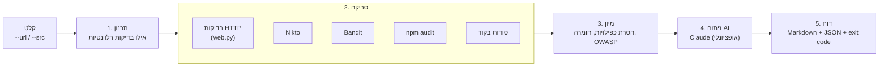

# משימה מס' 11 - אבטחה

## 🛡️ Sentinel: סוכן אבטחה לסריקת אתרים ושירותים

Sentinel הוא סוכן שסורק אתר או שירות ואת קוד המקור שלו, וממפה כל ממצא לקטגוריה ב-[OWASP Top 10:2025](https://top10.owasp.org/2025/). הוא מריץ בדיקות משלו ומפעיל כלים מוכרים (**Nikto**, **Bandit**, `npm audit`). אם מוגדר מפתח API, Claude מנתח את התוצאות ובונה תוכנית תיקון בעברית לפי סדר עדיפויות.

> ⚠️ **שימוש אתי:** סורקים רק מערכות שבבעלותכם או שקיבלתם אישור לבדוק. כדי לסרוק כתובת שאינה `localhost` הסוכן דורש את הדגל `--authorized`. הבדיקות שולחות מעט בקשות, עם השהיה ביניהן, ובלי לשנות נתונים.

## איך הסוכן עובד



1. **תכנון:** לפי הקלט (כתובת, תיקיית קוד, נתיבים לבדיקה) הסוכן מחליט אילו מודולים להריץ.
2. **סריקה:** כל מודול רץ בנפרד. אם כלי לא מותקן, הסוכן מדלג עליו ומציין זאת בדוח. כשל במודול אחד לא עוצר את שאר הסריקה.
3. **מיון:** הסרת כפילויות, מיון לפי חומרה, ציון סיכון מ-0 עד 100.
4. **ניתוח AI:** Claude מקבל את הממצאים ומחזיר תמונת מצב, סדר עדיפויות לתיקון, וחשד ל-false positives. הממצאים מסומנים למודל כ**נתונים בלבד**, כי אתר זדוני יכול להחזיר טקסט שמנסה להזריק הוראות לסוכן.
5. **דוח:** `reports/*.md` לקריאה, `reports/*.json` לאוטומציה, ו-exit code 1 כשיש ממצא בחומרה שנקבעה (`--fail-on`), כדי לשמש שער ב-CI.

## מה נבדק

| בדיקה | OWASP 2025 | מה הסוכן עושה |
|---|---|---|
| כותרות אבטחה | A02 | בודק CSP, X-Frame-Options, nosniff, Referrer-Policy ו-HSTS |
| חשיפת טכנולוגיה | A02 | מחפש `X-Powered-By` וגרסה בכותרת `Server` |
| קבצים רגישים | A02 | מנסה לגשת ל-`/.env`, `/.git/config`, `/db.json` ועוד |
| HTTPS | A04 | בודק אם האתר נגיש ב-HTTP לא מוצפן |
| דגלי עוגיות | A04 | בודק `HttpOnly`, `Secure`, `SameSite` |
| עוגייה צפויה | A07 | מזהה ערך קצר ופשוט (סימן לעוגייה לא חתומה) |
| **עוגייה מזויפת** | A07 | שולח עוגייה שנכתבה ביד לנתיב מוגן ובודק אם התקבלה |
| גישה ללא התחברות | A01 | בודק אם נתיבים מוגנים נפתחים בלי התחברות |
| CSRF | A01 | שולח POST עם `Origin` של אתר זר |
| CORS | A01 | בודק אם השרת מאשר כל מקור, כולל עם עוגיות |
| הגבלת קצב | A06 | שולח 15 בקשות ברצף ובודק אם מתקבל 429 |
| טיפול בשגיאות | A10 | שולח JSON פגום ובודק אם חוזרת שגיאת 500 או stack trace |
| **Nikto** | A02/A03/A05 | סריקת שרת ווב מקיפה (אלפי בדיקות ידועות) |
| **Bandit** | A02/A04/A05/A07/A08/A10 | ניתוח סטטי של קוד Python, כולל מיפוי של מזהי הבדיקות ל-OWASP |
| `npm audit` | A03 | מחפש ספריות פגיעות בפרויקטי Node |
| סודות בקוד | A04 | מחפש מפתחות API, מפתחות AWS, טוקנים ומפתחות פרטיים (מוצגים מוסתרים בדוח) |

## התקנה והרצה

```bash
cd security-agent
pip install -r requirements.txt
```
```bash
sudo apt install nikto   # אופציונלי
```

**סריקה בסיסית** (כתובת וקוד):
```bash
python -m sentinel --url http://localhost:3000 --src ..
```

**סריקה מלאה של "משימה 8"** (כולל התחברות, CSRF ועוגייה מזויפת):
```bash
python -m sentinel --url http://localhost:3000 --src .. \
  --login-path /api/session --login-body '{"userId":"m1"}' \
  --csrf-path /api/session \
  --protected /api/notifications --forged-cookie "demo_user=m1" \
  --error-path /api/tasks
```

**עם ניתוח AI:** מגדירים `ANTHROPIC_API_KEY` ומריצים כרגיל. אפשר להחליף מודל עם `SENTINEL_MODEL`. בלי מפתח, הסוכן עובד בלי שלב הניתוח.

**סריקת אתר מרוחק** (רק באישור):
```bash
python -m sentinel --url https://my-site.example --authorized
```

## תוצאה אמיתית: "משימה 8" לפני התיקונים ואחריהם

הרצתי את Sentinel על המערכת מ[משימה 8](../README.md) פעמיים: על הגרסה המקורית ועל הגרסה אחרי תיקוני האבטחה ([docs/security.md](../docs/security.md)).

| | לפני ([דוח](reports/task8-before.md)) | אחרי ([דוח](reports/task8-after.md)) |
|---|---|---|
| ציון סיכון | **98/100** | **0/100** |
| קריטי | 1: עוגייה מזויפת `demo_user=m1` נותנת גישת מנהל | 0 |
| גבוה | 2: CSRF, ועוגייה לא חתומה | 0 |
| בינוני | 5: CSP, Clickjacking, `uuid` ו-`exceljs` פגיעות, אין הגבלת קצב | 0 |
| נמוך | 3: `X-Powered-By`, nosniff, Referrer-Policy | 0 |

הסוכן מצא בעצמו את כל מה שמצאתי בבדיקה הידנית, ואחרי התיקונים אישר שכולם נסגרו.

## בדיקות הסוכן עצמו

```bash
python -m unittest discover -s tests
```
```bash
bandit -r sentinel   # הסוכן נסרק בכלי שהוא מפעיל: 0 ממצאים
```

הבדיקות מרימות שני שרתים מקומיים: **שרת פגיע**, שבו הסוכן חייב למצוא את כל 13 סוגי הבעיות, ו**שרת מוקשח**, שבו הוא חייב להחזיר 0 ממצאים (בדיקת false positives). יש גם בדיקות לזיהוי סודות ולהסתרתם, למיפוי Bandit ל-OWASP, ולחסימת סריקה של יעד מרוחק בלי `--authorized`.

ב-GitHub Actions ([security-agent.yml](../.github/workflows/security-agent.yml)) הסוכן נבדק בכל שינוי. אחר כך הוא בונה את "משימה 8", מתקין Nikto, סורק את האפליקציה ומעלה את הדוח כ-artifact.

## מבנה

```
security-agent/
├── sentinel/
│   ├── agent.py     # CLI, תכנון, הרצה, מיון, exit code
│   ├── web.py       # בדיקות HTTP (stdlib בלבד)
│   ├── tools.py     # Nikto, Bandit, npm audit, סודות
│   ├── ai.py        # ניתוח עם Claude (אופציונלי)
│   ├── report.py    # דוח Markdown + JSON, ציון סיכון
│   └── findings.py  # מודל ממצא + קטלוג OWASP 2025
├── tests/test_agent.py
└── reports/         # דוחות לדוגמה (לפני ואחרי)
```

## מגבלות

- זה **סורק**, לא בודק חדירות: הוא לא מוצא בעיות לוגיות מורכבות (למשל עובד שרואה משימה של עובד אחר). בשביל זה צריך בדיקות בתוך הקוד, כמו ב-`tests/` של משימה 8.
- בדיקת ה-CSP בודקת רק אם הכותרת קיימת ואם יש בה `unsafe-eval`, לא את כל המדיניות.
- הזרקת הוראות דרך מסמכים (A05 ב-[docs/security.md](../docs/security.md)) לא ניתנת לזיהוי מבחוץ, ונבדקה בבדיקות יחידה.
